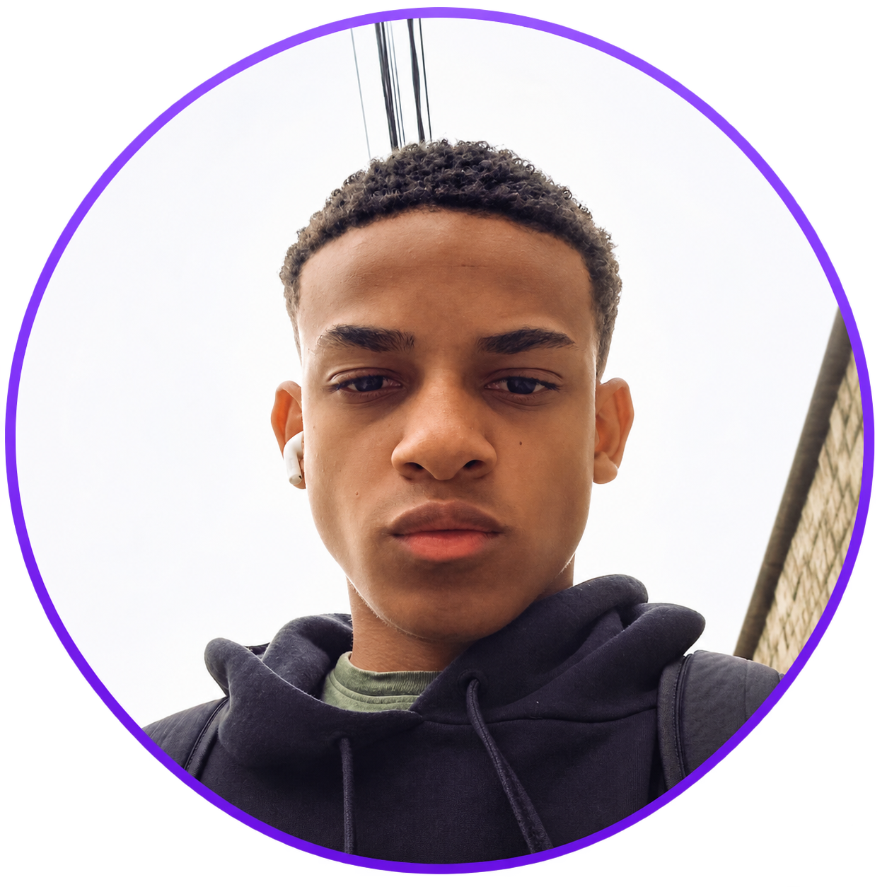

  <h1>Hello, I'm Vitor Miranda!</h1>

  

  <h3>Computer Science Student @ UFJF | Aspiring Backend Developer</h3>

  
Building solutions, exploring technologies and turning ideas into real projects.

---

## About Me

I'm a Computer Science student at the Federal University of Juiz de Fora (UFJF), Brazil.

I'm currently focused on backend development, especially with Node.js and TypeScript.

- Studying Computer Science at UFJF
- Learning Backend Development and Software Engineering
- Building RytmoAI, a personal productivity assistant
- Interested in Cybersecurity and Artificial Intelligence
- Working towards an international career in technology

---

## Tech Stack

---

## Featured Project

### RytmoAI

An intelligent productivity assistant designed to help users organize tasks, manage routines and improve their productivity.

**Technologies:** Node.js, TypeScript

**Status:** In Development

---

## Currently Learning

I'm currently expanding my knowledge in backend development and software engineering.

- **Node.js & TypeScript** — Building backend applications
- **REST APIs** — HTTP methods, endpoints and API design
- **Databases** — SQL, PostgreSQL and data modeling
- **Software Engineering** — Git, clean code and best practices

My current goal is to strengthen my backend skills and prepare for my first internship opportunity.

---

## GitHub Statistics

---

### Always learning. Always building.

